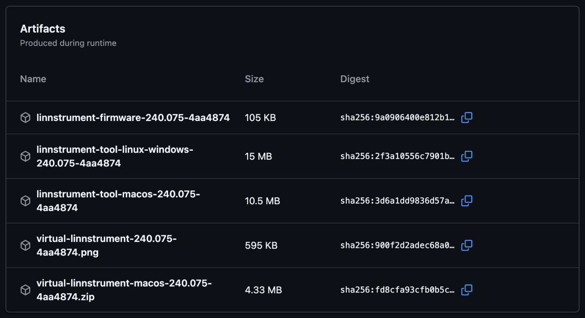
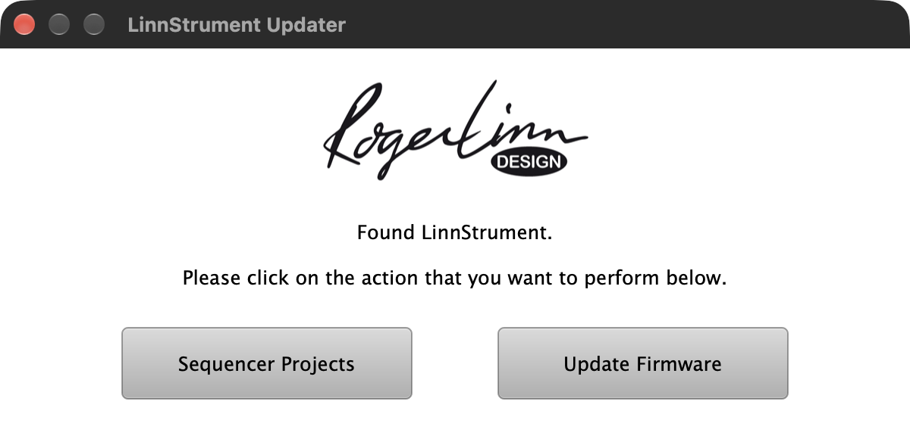

Contributing to the LinnStrument firmware
=========================================

This guide is for anyone who wants to fix a bug or add a feature, whether you
write the code yourself or work with an AI coding assistant. It describes the
workflow that keeps changes easy to review and safe to ship. If you only want
to use the browser pages with your instrument, `examples/README.md` is all
you need. You'll find a glossary of the terms used here at the end.

Bug reports and feature requests from customers go to
support@rogerlinndesign.com, not to this repository. GitHub issues are
disabled.

On the web, start to finish
---------------------------

To change the firmware with Claude Code on the web, with nothing installed:

1. Fork the repository and enable Actions on the fork ("Getting the code").
2. Open claude.ai/code, connect GitHub and pick your fork ("Setting up").
3. Describe the change as what the instrument should do ("How to brief it").
4. Read what it changed, and say yes when it asks to push: pushing starts the
   build.
5. Wait for the Actions run to show a green tick and download the firmware
   from it ("Building"). A red cross offers nothing: tell the assistant.
6. Before the first flash, read "What is safe and what is not": how to go
   back, and what to save first.
7. Flash it with the Updater and check the firmware name it shows ("Flashing
   and testing on the instrument").
8. Try it on the instrument and tell the assistant what you saw and heard.


Getting the code
----------------

* Collaborators with write access create branches directly in this
  repository.
* Everyone else forks it on GitHub with the Fork button at the top right of
  github.com/rogerlinndesign/linnstrument-firmware, and creates branches in
  the fork. Before the first push, open the fork's Actions tab once and click
  the green button that enables workflows. Until you do, a push builds
  nothing.
* To work on your own computer, clone it with
  `git clone https://github.com/YOU/linnstrument-firmware` or with GitHub
  Desktop. The folder must be named `linnstrument-firmware`, or the Arduino
  build refuses it. Note that a "Download ZIP" copy unpacks as
  `linnstrument-firmware-master`, so it needs renaming before it builds.
* Always start from `master`. That's the current development state and the
  base for the next release. If your fork is older, "Sync fork" on GitHub
  brings it up to date first. The `stable` branch is historical and years
  behind.
* Make one branch per topic, meaning one bug or one feature, and name it after
  you and the topic, for example `dev/roger-transpose-switch`. A branch name
  must not contain spaces, apostrophes or other punctuation besides `-`, `_`
  and `/`.

GitHub Desktop is fine for creating branches, looking at changes and pushing.
If an AI assistant does the editing and committing, you'll rarely need
anything else.


What to install
---------------

You don't need to install anything for the browser pages, and the same goes
for changing the firmware with Claude Code on the web and the LinnStrument
Updater (see "Working with an AI coding assistant"). For development on your
own computer, here's what you need, roughly in this order:

* **Git and a GitHub account.** GitHub Desktop covers branches and pushing.
  The branch dropdown on your fork's GitHub page creates a branch with
  nothing installed.
* **Claude Code**, if you want an assistant. The installers are at
  claude.ai/code. You start the terminal program by typing `claude` in this
  folder, while the VS Code extension opens the folder instead. Both read
  `CLAUDE.md` on their own.
* **Go 1.25 or later** (go.dev/dl) and **arduino-cli** (arduino.github.io)
  each come as a single installer. After that, run this once:
  `arduino-cli core install arduino:sam@1.6.12`. On a Mac with Homebrew,
  `brew install go arduino-cli cmake` installs both, and CMake too. If you
  build in the Arduino IDE instead you need neither, but the tests still need
  Go.
* **Without Go**, you can use the prebuilt tool that every green Actions run
  attaches. It does `backup`, `restore`, `flash`, `update` and `serve`. Unzip
  `linnstrument-tool-macos` or `linnstrument-tool-linux-windows`, followed by
  the version and commit, and put the binary in the repository folder. A
  "Download ZIP" copy will do, since it holds the bossac the tool flashes with
  and the pages it serves. Before the first run, open a terminal in that
  folder and type:

  ```
  chmod +x linnstrument-macos
  ```

  The zip drops the file's executable flag, and without it the terminal says
  "permission denied". On Linux, type the same for `linnstrument-linux-amd64`
  or `linnstrument-linux-arm64`. The macOS tool from this repository's runs is
  signed with a Developer ID and notarised, so macOS checks it with Apple on
  its first run, which needs an internet connection. A build without those
  credentials, such as a pull request from a fork, is not notarised, and
  macOS kills it or says Apple could not verify it. For that one, also type:

  ```
  xattr -d com.apple.quarantine linnstrument-macos
  ```

  Then run it from that folder, for example `./linnstrument-macos ports`.
* **macOS:** the Xcode Command Line Tools (`xcode-select --install`) and, on
  Apple silicon, Rosetta (`softwareupdate --install-rosetta`), which the
  Arduino compiler needs. **Linux:** g++, and your user in the serial port
  group. **Windows:** MinGW for the desktop tests.
* **CMake 3.22 or later** for the Virtual LinnStrument. Its first build
  fetches JUCE and takes a few minutes, and later builds take about twenty
  seconds.
* Optional: **Node** for the example pages' tests, **Docker** for
  `tools/ci-linux.sh`, and **sendmidi** and **receivemidi** (github.com/gbevin)
  and **RouteMIDI** for MIDI from the shell or as tools for the assistant.
  `.mcp.json` registers two MCP servers, which Claude Code asks you to approve
  the first time it starts here. The first is the Virtual LinnStrument's
  (`go run ./tools/linnstrument mcp`), whose tools tell you when the app isn't
  built yet or another copy of it is running. The second is RouteMIDI's,
  which fails at startup when RouteMIDI isn't installed, and that's harmless.

Once that's done, `go run ./tools/linnstrument test` (a few seconds) and
`go run ./tools/linnstrument build` (a minute or two the first time, about ten
seconds after that) prove that your setup works.


Building
--------

There are three ways to build, and they all produce the same firmware:

1. **Arduino IDE 2.x.** Install the "Arduino SAM Boards (32-bits ARM
   Cortex-M3)" core, version 1.6.12. Then copy the folder
   `libraries/DueFlashStorage` from this repository into the `libraries`
   folder of your sketchbook (`Documents/Arduino/libraries` on macOS and
   Windows, `~/Arduino/libraries` on Linux), since the IDE doesn't look in the
   repository's own `libraries`. Select the board "Arduino Due (Native USB
   Port)", open `linnstrument-firmware.ino` and press Verify. "Sketch > Export
   Compiled Binary" then writes the `.bin` into
   `build/arduino.sam.arduino_due_x/`.
2. **Command line.** `go run ./tools/linnstrument build` runs arduino-cli and
   writes the `.bin` into `build/`. Once the core has been compiled, this takes
   about ten seconds. See "What to install".
3. **GitHub Actions.** Every push to any branch, and every pull request, is
   compiled automatically. Open the "Actions" tab on GitHub, click the run for
   your commit, and download the firmware from "Artifacts" at the bottom. The
   download is a zip, so unzip it to get the `.bin`. The same run attaches
   prebuilt `linnstrument` tool binaries for Linux, Windows and macOS, the
   Virtual LinnStrument for Apple silicon Macs, and a screenshot of it
   running. Every artifact is named after the firmware version and the commit,
   for example `linnstrument-firmware-240.075-1a2b3c4` for the firmware,
   `virtual-linnstrument-macos-240.075-1a2b3c4.zip` for the app and
   `virtual-linnstrument-240.075-1a2b3c4.png` for the screenshot. The tool
   tells you the same with `./linnstrument-macos version`, and the app in its
   window title and status line. Note that downloading needs a GitHub login,
   and GitHub keeps artifacts for 90 days by default. Only a run with a green
   tick offers downloads. The builds start once the tests pass, and a run that
   ends with a red cross deletes what it had attached. A pull request from a
   fork can't delete, so its red run keeps them. On a fork the runs are on the
   fork's own Actions tab, which asks once to enable workflows with a green
   button. "Run workflow" there builds a branch without a new push. This needs
   no software on your computer at all.

   

A build of `master`, or of a branch made from it, is the development version
of the next release. This means the instrument reports version 2.4.0 and
carries every change made since 2.3.4, not only yours.

Apple is ending Rosetta after macOS 27, so the GitHub Actions build is the
reliable long-term path on Macs.

On Linux, your user must be in the group that owns the serial port (`dialout`
on Debian and Ubuntu, `uucp` on Arch). Note that ModemManager may hold the
port for a few seconds after the LinnStrument enters serial mode.


Desktop tests
-------------

`go run ./tools/linnstrument test` compiles the firmware for your computer and
runs the tests in `tests/` in a few seconds, with no instrument attached.
`test NAME` runs only the tests whose name contains NAME. That match is
case-sensitive, and a NAME no test contains is an error. `mutate` proves every
test can fail at about six seconds per test, which takes over ten minutes for
all of them, and `mutate NAME` checks the tests whose name contains NAME.

The tests cover the logic that can be checked without hardware: note layout,
velocity, phantom touch rejection, settings migration, MIDI and serial
framing. Run them before every push, and add one when you fix a bug in logic
they can reach. `tests/README.md` explains how to write one. GitHub Actions
runs them on every push as well, together with `go vet ./...`,
`go test ./...`, `go run ./tools/linnstrument nrpns` (which checks the NRPN
table in midi.md against the firmware) and
`node --test examples/browser/*.test.js` for the pages. It also builds the
Virtual LinnStrument on macOS. `tools/ci-linux.sh` runs the test, build and
tool jobs in an x86_64 Ubuntu container with Docker, so that you can check a
change on Linux before pushing it. `tools/build-name.sh` prints the name
those builds carry, such as `240.075-1a2b3c4`.


`go run ./tools/linnstrument serve` serves the browser pages in
`examples/browser/` on a local port and opens them, and `examples/README.md`
describes the pages. They're published at https://uwyn.com/linnstrument/ with
`tools/deploy-pages.sh`, which needs the maintainer's access to that server
and `LINN_PAGES_TARGET` naming it; `-n` shows what it would change. After a
change to their layout, paste `tools/layout_sweep.js` into Chrome's DevTools
console on one of them. It loads every page at widths from a phone to a wide
screen, for both models, and lists what overflows.

`tools/virtual/` builds Virtual LinnStrument. That's the same firmware running
on your computer behind a window that shows its lights, takes the mouse as a
finger and has a virtual MIDI port, so that you can try a change without an
instrument on the desk. Its README explains the CMake build, how
`go run ./tools/linnstrument mcp` serves it to an AI assistant as an MCP
server, and how `tools/virtual/build-release.sh TAG` builds it from an older
firmware release.

What is safe and what is not
----------------------------

* The browser pages change nothing on the instrument beyond the settings and
  lights you ask for. User Firmware Mode, which the designer and the console
  use, is off again after a power cycle.
* The LinnStrument Updater keeps settings, calibration and sequencer
  projects: it reads them from the unit, flashes, and sends them back. It
  holds them only in memory for that one update and writes no backup file.
  `go run ./tools/linnstrument update` does the same from the command line and
  also writes them to a backup file. `flash` on its own, bossac and the
  Arduino IDE erase settings and calibration; the unit then starts in serial
  mode and asks to be calibrated.
* An assistant may flash a unit only when you say so in that conversation
  (`CLAUDE.md` makes that a rule). In the terminal and VS Code setups the
  command allowlist in `.claude/settings.json` covers building the firmware,
  testing, probing and backing up but never flashing or restoring, so those
  always ask you first.
* The official firmware is always at hand: the Updater download carries it
  (see "Flashing and testing on the instrument"). Keep the downloaded zip.
  Going back is running an Updater freshly unzipped from it, with no other
  `.bin` beside it, and checking that its confirmation line says `2.3.4`. With
  the tool installed, also keep a `go run ./tools/linnstrument backup` file
  from before the first flash.
* Going back to an older firmware after a change to the settings layout
  resets the settings and the calibration to their defaults, although the
  Updater still says it finished; the unit then starts on its calibration
  screen. The Updater keeps no copy of either. Before the first flash of such
  a change, write down the settings you care about and save each sequencer
  project you want to keep to a file: in the Updater, click Sequencer
  Projects, pick the project and click Receive From LinnStrument. A change
  that adds no setting goes back cleanly, with one exception: if it adds a new
  choice to an existing setting (a low row mode, a switch assignment, a
  sensitivity level), set that setting back to a choice the official firmware
  has before going back, because the official firmware would read a value it
  does not know.
* Recovery when a flashed build misbehaves but still runs: tap Global
  Settings, briefly tap OS Update (column 16, third row from the bottom;
  holding it starts User Firmware Mode instead), and go back with the official
  Updater as above.
* Recovery when it does not run, hangs, or the settings screens no longer
  work: unplug the USB cable, hold only the Global Settings button while
  plugging it back in, and keep holding until FWUP (FWU on a 128) shows in
  red. The unit then runs nothing but waits for an update. Run the official
  Updater as above. After a while, up to half a minute, it says "Couldn't
  retrieve LinnStrument's settings, interrupting firmware upgrade." That is
  expected here: click "Go ahead with default settings" under it. Settings and
  calibration are lost that way, so calibrate afterwards, and use
  `go run ./tools/linnstrument restore FILE` if you had a backup made with the
  tool. Holding Global Settings together with switch 2 at power on does a
  global reset instead.
* The one way to make a unit unreachable over USB is a build that breaks the
  start of `setup()`, the lines marked `/*!!*/` and what they call before that
  check (sensor, calibration and LED setup); the unit then has to be opened to
  reach the Due's erase button. `CLAUDE.md` forbids an assistant to change
  those lines.


Flashing and testing on the instrument
--------------------------------------

Flash the `.bin` with the LinnStrument Updater, the same tool customers use,
from the [update page on
rogerlinndesign.com](https://www.rogerlinndesign.com/support/support-linnstrument-update-software).
It flashes the `.bin` that sits in the same folder as the app, the most
recently created one if there are several. With none there, the Mac app uses
the firmware built into it, so on a Mac there is no way to pick a file, and
the Windows app asks for one. The downloads differ:

* **Mac.** The zip holds only `LinnStrument Updater.app`, with the release's
  firmware built in.
* **Windows.** The zip holds a folder with `LinnStrument Updater.exe`, a
  `tools` folder and the release's `linnstrument-firmware-2.3.4.bin`.

To flash your own build, make a new folder for it and add your `.bin` from the
Actions download, keeping its name.

* **Mac.** Unzip the Updater download and drag the app into the new folder
  with Finder (moving or copying both work). Do not run it where it was
  unzipped with the `.bin` put beside it there: macOS runs a downloaded app
  that never left that spot from a hidden copy, which does not see the file.
* **Windows.** Copy the contents of the unzipped folder into the new folder,
  without its `linnstrument-firmware-2.3.4.bin`.

Keep the downloaded zip for going back. When a new build replaces an older
one, delete the older `.bin` from the folder first. Then:

1. Connect the unit directly, without a USB hub, and on the instrument tap
   Global Settings, then briefly tap OS Update (column 16, third row from the
   bottom).
2. Open the Updater from your new folder and click Update Firmware.
3. Read the line "You're about to upgrade LinnStrument using firmware ...".
   It names the file without its `linnstrument-firmware-` prefix, so a build
   from Actions shows `240.075-` followed by the commit. If it shows `2.3.4`,
   the Updater did not find your file: quit and check the folder. If the file
   is there, you are most likely running the app where it was unzipped: drag
   it into the folder with Finder and open it from there.
4. Click Go Ahead. The Updater reads the settings, flashes, and sends them
   back.



For developers, `tools/linnstrument` does from the command line what the
Updater does, with the Updater's signed bossac for macOS and Windows bundled
in `tools/bossac/` (see its README) so no Arduino installation is needed.
`go run ./tools/linnstrument update` backs up the settings and sequencer
projects, flashes `build/linnstrument-firmware.ino.bin` and restores them.
`flash` alone erases the settings, `backup` and `restore` move them
separately, and `probe` confirms that a unit in serial mode is talking.
`midimode` and `serialmode` switch the unit between its two USB personalities
from the command line; the latter sends NRPN 271 through
[sendmidi](https://github.com/gbevin/SendMIDI), which must be installed. Run
the tool without arguments for the full list.

Before considering a change done, test on the instrument:

* The thing you changed works as intended.
* The feature it is closest to still works (the same screen, the same switch,
  the other split).
* Settings survive a power cycle and, for anything touching settings, a flash
  with the Updater from the previous firmware.
* If you own a LinnStrument 128 and 200, try both. If not, say which one you
  tested on.
* Check the MIDI output with a MIDI monitor when the change affects what is
  sent.


Commits
-------

* One change per commit. Don't mix a bug fix with an unrelated cleanup.
* Message: one line in the past tense, describing what changed, just like the
  existing history: "Added ...", "Fixed ...", "Changed ...".
* Never change `OSVersion` or `OSVersionBuild`. Version numbers are bumped by
  the maintainer when a release is assembled.
* Don't commit `build/`, and don't commit the `port` line in
  `.vscode/arduino.json` if it changed for your machine.
* Leave the debugging `#define` switches at the top of
  `linnstrument-firmware.ino` commented out.


Pull requests
-------------

Open one pull request per branch, against `master`. In the description, say:

* What changed and why, in a few sentences.
* How you tested it, on which model, and which firmware you upgraded from.
* Anything you're unsure about.

The maintainer (Geert) reviews every pull request, may ask for changes, and
merges it. Merged changes go out in the next firmware release, usually
together with other changes, so there's no need to coordinate release timing.

Small pull requests get reviewed quickly. A pull request that touches many
files for several reasons will wait.


Working with an AI coding assistant
-----------------------------------

The file `CLAUDE.md` in this repository is read automatically by Claude Code.
It tells the assistant how the firmware is built, what it must not do, and
how a change is verified, so you don't need to repeat any of that. Other
assistants, such as Codex or Cursor, read `AGENTS.md`, which sends them to
the same file.

### How the work is divided

The work happens in four stages, and each one settles something the previous
one can't:

1. **The assistant** edits the code and runs the desktop tests in `tests/`,
   which check the firmware's logic in seconds: note layout, velocity,
   settings, MIDI, the serial protocol. A change that breaks them isn't done.
2. **The Virtual LinnStrument** (`tools/virtual/`) runs the real firmware on
   your computer. The assistant can drive it through the MCP server
   (`go run ./tools/linnstrument mcp`) to press cells, read the lights, send
   and receive MIDI and take a screenshot. That settles what the lights and
   the MIDI do.
3. **Your instrument** settles feel, pressure, timing and sound. Only a person
   at the unit can do that, and the assistant flashes it only when you say so.
4. **GitHub Actions** is the build of record. Every push is compiled and the
   firmware is attached to the run, so that a reviewer, and you on another
   machine, get the same binary.
### Setting up

* **Claude Code on the web** (claude.ai/code): connect your GitHub account,
  pick your fork of this repository (the repository itself if you are a
  collaborator), and work from the browser. Create the branch first, from the
  branch dropdown on the fork's GitHub page, or ask the assistant to create it
  as its first task; then it edits on that branch in the cloud, commits, and
  can open the pull request. It may make a branch of its own, named
  `claude/...`; then that is your branch. It asks before every commit and
  push: saying yes is safe, and pushing is what starts the build. Nothing
  needs to be installed. It cannot compile there, and whether it can run the
  desktop tests depends on its cloud environment (it says so), so the loop is:
  ask, review the change, have it push, wait for the Actions run (enabled on
  the fork once, see "Getting the code"), download the `.bin`, flash with the
  Updater, test. A red run means a check failed and nothing was offered: tell
  the assistant, which reads the failure and pushes a fix. The same green run
  also offers the Virtual LinnStrument for Apple silicon Macs, built from your
  change: a way to see it run before it touches the instrument (its README
  says how to open it).
* **Claude Code in VS Code**: install the Claude Code extension, open the
  repository folder, and chat in the side panel. Same workflow, with the files
  visible next to the conversation, and with the toolchain installed it
  compiles and tests on your machine.
* **Claude Code in the terminal**: type `claude` in the repository folder.
  This is the fullest setup: it compiles, runs the tests, drives the Virtual
  LinnStrument and, with your permission, a connected instrument. The first
  time it runs a command it asks; `.claude/settings.json` pre-approves
  building the firmware, testing, probing and backing up, never flashing.

Either way, make sure you're on your own branch before you start, and tell
the assistant the branch name.

### Your first session

Here are a few prompts that work as they are, and you can adapt them to your
own change. The third one needs the terminal or VS Code setup, since on the
web the assistant pushes instead of compiling:

> I am on a LinnStrument 200 with firmware 2.3.4, on the branch
> dev/me-played-colour. Read CLAUDE.md and CONTRIBUTING.md and tell me in a
> few lines how a change gets from here onto my instrument.

> Add an "All notes off" option for the foot switches, which sends all notes
> off on every channel the splits use. Run the desktop tests and compile where
> you can, otherwise push and point me to the Actions run, and give me the
> steps to check it on the instrument.

> Build the Virtual LinnStrument, start it, play a few notes on it and tell me
> which lights came on and what MIDI it sent.

> Commit this on my branch with a one-line past-tense message, push, and tell
> me which Actions run to download the firmware from.

### How to brief it

Describe behaviour, not code. For instance, these are good briefs:

> When the low row is set to Strum and I release a note on the right split
> while holding one on the left, the right note keeps sounding. It should stop.
> I am on a LinnStrument 200 with firmware 2.3.4.

> Add a fourth Pressure Sensitivity choice, more sensitive than High.

Note that a change to a default value doesn't show on your instrument, because
the Updater restores your settings after flashing. Ask for a change in
behaviour instead, or set the value on the instrument.

Include what happens now, what should happen, how to reproduce it, and which
model and firmware you're on. If you know the settings involved, name them as
they appear on the instrument.

### What to ask of it, every time

1. **Compile and run the desktop tests before reporting back.** If it can't
   compile, as on the web, it should say so and point you to the Actions run
   instead of guessing. For anything about lights or MIDI, ask it to try the
   change on the Virtual LinnStrument too.
2. **Explain the change in plain words** and list the files it touched. If the
   explanation doesn't match what you asked, say so.
3. **Give you test steps** for the instrument: what to set, what to press, and
   what you should see or hear.
4. **Commit on your branch only**, one commit per change, with a one-line
   past-tense message. No version bumps, and no commits to `master`.
5. **Keep the change small.** If it proposes a rewrite or a cleanup of code
   you didn't ask about, decline it and ask for the minimal change.

### What it can and cannot do

It can compile, run the desktop tests, run the firmware in the Virtual
LinnStrument and read its lights and MIDI. With your word, it can also flash a
unit and back up and restore its settings. It can't feel the surface, hear
anything, or judge timing and pressure, so for those you are the test harness.
When it says "this should work", it means "this compiles, passes the tests and
behaves on the virtual instrument". On the web it can do none of that itself.
There, a green Actions run is the compile and the tests, and nothing has run
your change until you try it on the Virtual LinnStrument or the instrument.
Only your test on the instrument settles the rest.

If it tells you that an existing constant or check "looks like a bug", look at
the "Things that look wrong but are deliberate" list in `CLAUDE.md` before
letting it change anything. Several values in this firmware were tuned on
hardware and look arbitrary from the code alone.

### Iterating

Flash, test, and report back what you observed as precisely as you can, for
instance "the LED lit but no MIDI note was sent" or "the transpose went up two
semitones instead of one". If something touch or timing related doesn't
behave, ask it for a diagnostic first so that you report measurements, rather
than letting it guess at a second fix. Serial debug output needs a serial
terminal, such as the Arduino IDE's Serial Monitor, and the unit in serial
mode, where it plays no MIDI. Without those, ask for a diagnostic that the
lights show.

When the change works, ask it to open the pull request, or open it yourself
on GitHub, with a description as explained above. Note that a pull request is
optional, since a build from your fork is yours to keep using. Just open one
when you think others would want the change.


Glossary
--------

* **Fork, branch, pull request.** Your own copy of the repository on GitHub, a
  named line of changes inside it, and the request to take those changes into
  this repository.
* **GitHub Actions, artifact.** The builds GitHub runs on every push, and the
  files a run attaches: the firmware `.bin`, the tool and the Virtual
  LinnStrument.
* **`.bin`.** The compiled firmware file the Updater flashes.
* **Arduino core.** The compiler and libraries for the Due, installed once
  with `arduino-cli core install arduino:sam@1.6.12`.
* **Serial mode, MIDI mode.** The instrument's two USB personalities. It's a
  serial port while the Updater talks to it (OS Update in Global Settings),
  and a MIDI device the rest of the time.
* **Calibration.** The per-unit measurement of the surface's X and Y. It's
  kept with the settings and lost when a flash erases them.
* **NRPN, CC.** MIDI messages: a control change number with a value, and a
  numbered parameter sent as four of them. `midi.md` lists the instrument's.
* **User Firmware Mode.** The mode in which the instrument sends raw touches
  and takes lights over MIDI, which the browser pages use
  (`user_firmware_mode.md`).
* **Desktop tests, mutation.** The checks in `tests/` that run on your
  computer, and the proof that each one can fail (`tests/README.md`).
* **MCP server.** The way an assistant gets tools.
  `go run ./tools/linnstrument mcp` offers the Virtual LinnStrument's commands
  as tools, and RouteMIDI's offers MIDI ports.
* **Virtual LinnStrument.** The firmware running on your computer behind a
  window (`tools/virtual/README.md`).
