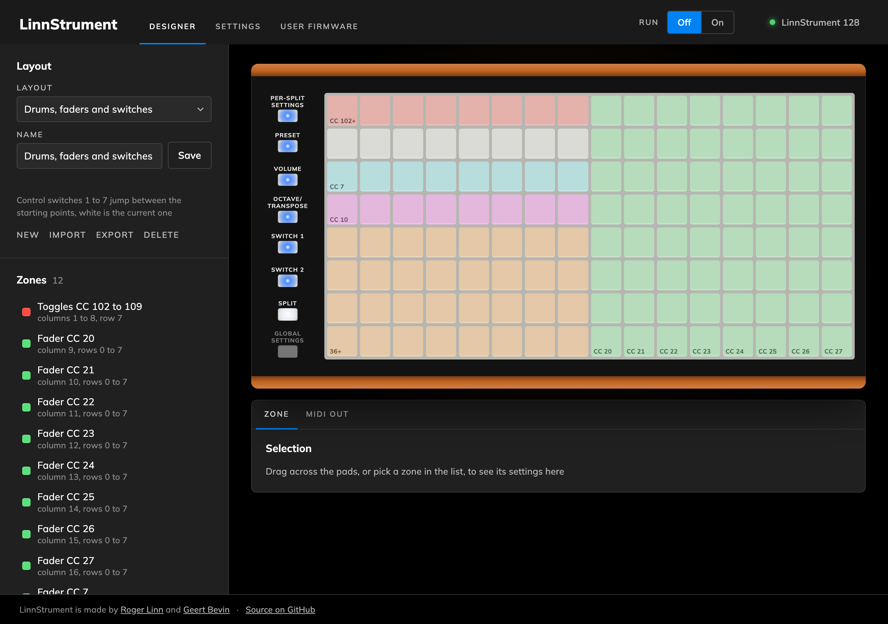
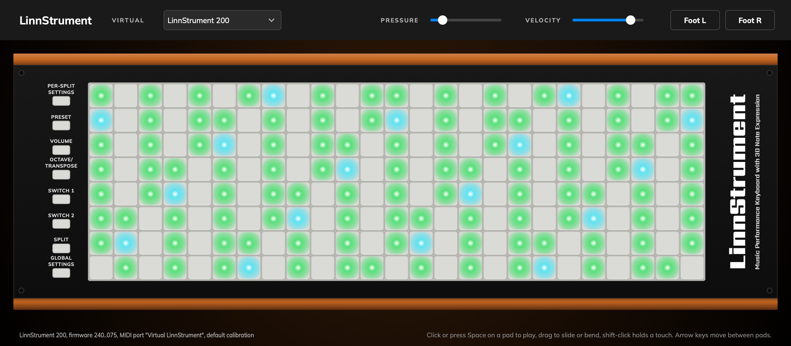

LinnStrument
============

This is the firmware for LinnStrument, the expressive MIDI controller made by Roger Linn Design,
together with the tools around it. The firmware runs on the Arduino Due inside the instrument.
The repository is set up so that anyone can work on it with an AI coding assistant, musicians
included, not only programmers.

Three ways in
-------------

1. **Use the browser pages, nothing to install.** The [browser pages](examples/README.md) talk
   to a LinnStrument over MIDI from Chrome, Edge or Firefox. There's a surface designer that
   turns the instrument into a custom controller of pads, keys, faders, XY pads and buttons for
   any DAW, an editor for every setting, and a live view of User Firmware Mode. Just open
   https://uwyn.com/linnstrument/ in Chrome, Edge or Firefox (Safari has no MIDI for web pages),
   allow MIDI when the browser asks, open one of the pages and pick the instrument at the top
   right. [examples/README.md](examples/README.md) describes them, and how to run them from a
   copy of this repository instead. They work with the current release,
   2.3.4. The next firmware, 2.4.0, isn't released yet and adds model detection, faster lighting
   and text. Until then, the connection panel tells you what's waiting for it.

2. **Change the firmware without installing anything.** Claude Code on the web edits the
   firmware on a branch in the cloud. Every push is compiled by GitHub Actions, which attaches
   the firmware file to the run, and the LinnStrument Updater flashes it while keeping your
   settings. "On the web, start to finish" in [CONTRIBUTING.md](CONTRIBUTING.md) lists the
   steps, and the rest of that file has the prompts to start with and tells you what's safe.

3. **Develop on your own computer, with or without an assistant.** Plain development works as it
   always has. You can open `linnstrument-firmware.ino` in Arduino IDE 2.x and press Verify,
   after copying its one library (see `CONTRIBUTING.md`), or build from the command line with Go
   and arduino-cli. A desktop test suite checks the firmware's logic in seconds without an
   instrument, the Virtual LinnStrument runs the firmware behind a window with a virtual MIDI
   port, and a pull request brings the change in. An AI assistant in the terminal can drive all
   of that for you and, when you say so, a connected instrument too. `CONTRIBUTING.md` lists
   what to install and the workflow. `CLAUDE.md` is what the assistant reads, and it's useful
   reading for people too.

For the browser pages, the first way in and `examples/README.md` are all you need. To change the
firmware, start with this file and then read `CONTRIBUTING.md`, which takes half an hour and
covers the workflow, safety and working with an assistant. After that, read `CLAUDE.md` when you
want to know how the firmware is built, how it runs and what it must not do.

Building
--------

The sources are an Arduino sketch. They build with Arduino IDE 2.x or with arduino-cli, using
the Arduino SAM Boards core version 1.6.12 (select the board "Arduino Due (Native USB Port)").
Other versions of the SAM core are untested and may create unknown build or execution problems.

To build from the command line, you need Go and arduino-cli installed. After running
`arduino-cli core install arduino:sam@1.6.12` once, `go run ./tools/linnstrument build` compiles
the firmware into `build/` and `go run ./tools/linnstrument test` runs the desktop tests in
`tests/`. The same tool flashes a unit and backs up and restores its settings. `tools/virtual/`
builds the Virtual LinnStrument. Every push to GitHub is also compiled by GitHub Actions, which
attaches the resulting `.bin` file, the tool and the Virtual LinnStrument for Apple silicon Macs
to the workflow run, so you don't have to install anything to get a build.

On Apple silicon Macs, the Arduino SAM toolchain is an Intel binary and needs Rosetta installed
(`softwareupdate --install-rosetta`).

Flash a `.bin` with the LinnStrument Updater, which keeps your settings. It flashes the `.bin`
in the folder it sits in, so on a Mac, drag the unzipped app into a folder holding your file.
Left where it was unzipped, it doesn't see the file. `CONTRIBUTING.md` has the steps and the way
back. Note that uploading with bossac or the Arduino IDE directly erases all settings and
calibration.

Contributing
------------

See `CONTRIBUTING.md` for the branch and pull request workflow, what to install, what's safe and
what isn't, and how to work on this code with an AI coding assistant.

Note that customer bug reports or feature requests shouldn't be posted here. Instead, email
Roger at support@rogerlinndesign.com.
